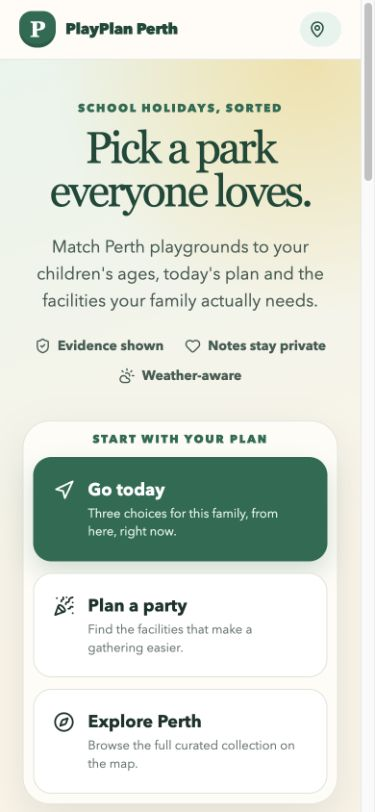
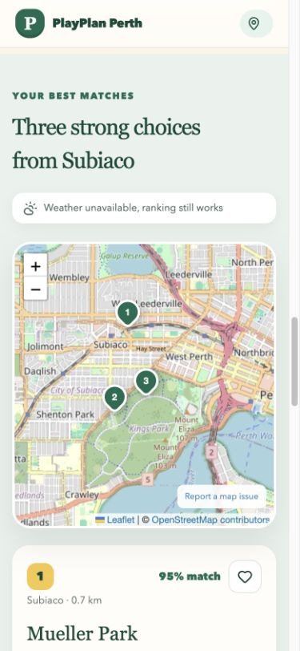
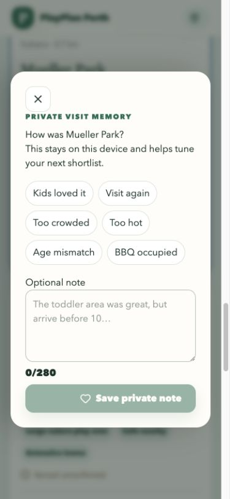
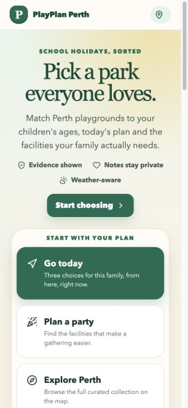
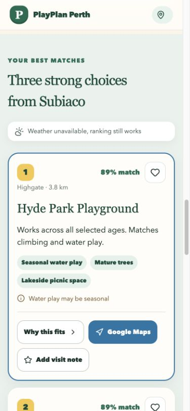
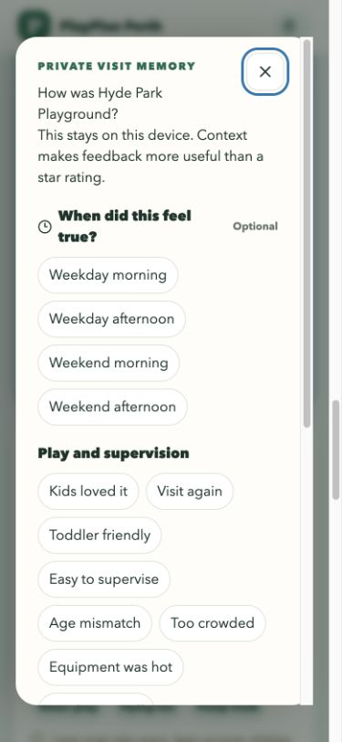

# PlayPlan Perth mobile journey audit

## Audit scope

Combined UX and visible accessibility review of the live `Go today` journey at a 390 by 844 mobile viewport. The goal was to choose a playground, understand the shortlist and record useful visit feedback.

## Step 1, choose a planning mode

Health: strong visual trust, moderate task-entry friction.

The positioning is clear and the three modes are easy to distinguish. The first real question begins below the first screen, so a parent who already wants `Go today` must scroll past a large introduction and mode card. A direct `Start choosing` action and tighter mobile spacing reduce that delay.

## Step 2, read the shortlist

Health: functionally strong, poor mobile information order.

The result heading, weather fallback and numbered map markers build confidence. On mobile, the map appears before the recommendation explanation, forcing the parent to scroll through a large map before learning why the first choice won. Recommendation cards should come first on narrow screens.

## Step 3, record a visit

Health: private and approachable, too shallow for community-quality evidence.

The dialog explains privacy well and uses large touch targets. The six original tags do not capture the reasons parents discuss publicly, especially sightlines, toddler fit, parking, pram access, toilet convenience and hot equipment. Crowd feedback also lacks weekday or weekend and time-of-day context.

## Highest-impact changes

1. Put recommendation explanations before the map on mobile.
2. Add a direct route from the hero to the questions.
3. Capture structured, contextual visit feedback and show it back on future result cards.
4. Restore the selected suburb and its coordinates together after refresh.
5. Make direct park links open the requested detail panel on first load.
6. Use honest result headings when only one or two destinations qualify.

## Verified update

### Faster task entry

The direct action is now visible in the first mobile viewport while preserving the original visual identity and planning modes.

### Recommendations before map

The first explainable recommendation now appears immediately after the results heading. The map follows the cards on narrow screens and remains beside them on desktop.

### Contextual parent feedback

Feedback now separates play and supervision from arrival practicalities, with optional weekday or weekend and time-of-day context. The dialog opens with keyboard focus on its close control and closes with Escape.

## Accessibility evidence limits

The screenshots support a visual review of hierarchy, target size and contrast risk only. Automated checks and keyboard tests are still required for labels, focus order, dialog focus, Escape handling, reduced motion and responsive reflow. Full WCAG 2.2 AA compliance is not claimed.
